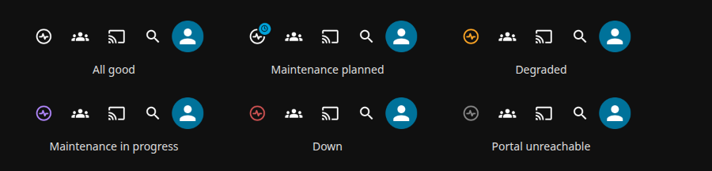
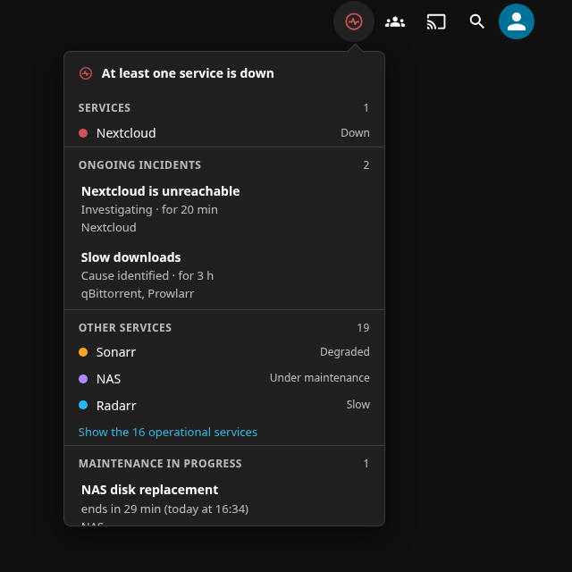
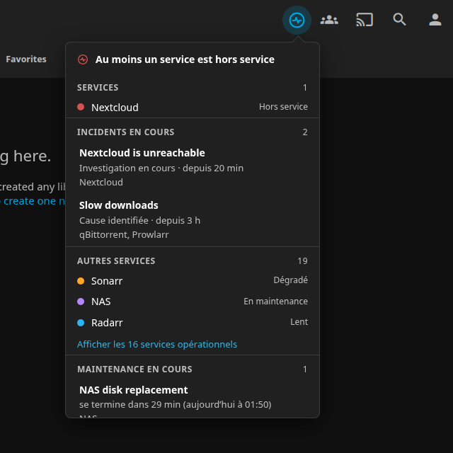
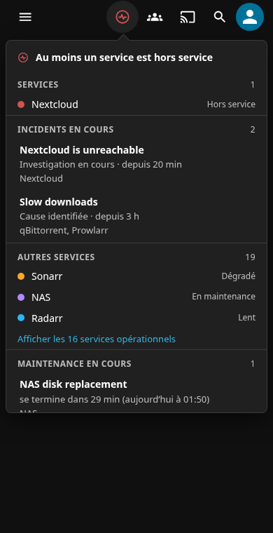

# Jelly-portal
A Status Portal integration as a Jellyfin Plugin

Jelly Portal adds a permanent icon to the header of the Jellyfin web client, next to the existing
header icons. The icon reflects the overall state of your self-hosted services as reported by your
[Status Portal](https://github.com/Adam4125-officiel/Status-Portal), and a click opens a small
bubble over the current page with the details: services, maintenance in progress or coming up, and
active announcements.

> **Status: stable release 0.1.0.** Everything described below works and has been checked in a real browser against a
> Jellyfin 12.2 and a stand-in portal that has the shape of the real one, and it has run against a real Status Portal
> 1.12.0 and on the owner's own Jellyfin. Not tried: Jellyfin Desktop, the Android app, a touch device, the TV layout.
> Install it from the **stable** repository below.

## Requirements

- **Jellyfin 12.2** (the plugin is built against `Jellyfin.Controller` 12.2.0; its `targetAbi` is
  `12.2.0.0`, so older servers are not offered it).
- The **[File Transformation](https://github.com/IAmParadox27/jellyfin-plugin-file-transformation)**
  plugin, 3.x. It is what lets Jelly Portal add its icon to the web client without modifying any
  jellyfin-web file. Without it Jelly Portal still loads, logs a warning, and shows no icon.
- A running Status Portal reachable from the Jellyfin server.

It only shows in clients built on jellyfin-web: browsers, Jellyfin Desktop and the Android app.
Android TV, Swiftfin, Findroid and similar clients will not show it.

## Installation

1. In Jellyfin, open **Dashboard > Plugins > Repositories** and add these repositories:
   - File Transformation: `https://www.iamparadox.dev/jellyfin/plugins/manifest.json`
   - Jelly Portal, **stable**:
     `https://raw.githubusercontent.com/Adam4125-officiel/Jelly-portal/manifest/manifest.json`
   - or Jelly Portal, **unstable** (release candidates and stable releases):
     `https://raw.githubusercontent.com/Adam4125-officiel/Jelly-portal/manifest/manifest-unstable.json`
2. In the **Catalog**, install **File Transformation**, then **Jelly Portal**.
3. Restart Jellyfin.

## Configuration

Dashboard > Plugins > **Jelly Portal** (also in the dashboard sidebar). Changes apply immediately, no restart.

| Setting | Default |
|---|---|
| Portal address, as the Jellyfin server reaches it (`http://192.168.1.10:5000`) | none |
| Public address of the portal, the one the bubble's "open the status portal" link points to (`https://status.example.com`). Optional | none: no link |
| Key of the portal's **Display device** API (portal administration, page *Display device*) | none |
| Visible to | all users / administrators only |
| Language of the bubble and of this page: **English**, **Français**, or **Auto** (each user's own Jellyfin language, and English when that is not French) | English |
| Priority services (one name per line): their maintenance and incidents are put forward in the bubble | none |
| "Maintenance coming up" window (1 h to 30 days) | 24 h |
| Browser refresh interval (10 s to 1 h) | 60 s |
| Server cache lifetime (5 s to 10 min): however many browsers are open, the portal is asked once per lifetime | 30 s |

The two addresses are separate on purpose. The first one is what the Jellyfin *server* uses to reach the portal and is
often a private address; it never leaves the server, and no browser ever receives it. The second is what your users
open: leave it blank and the bubble simply has no link.

The key stays on the server: it is never sent to a browser, and it is not shown again once saved (leave the field
blank to keep it). **Test the connection** tries the address and key as typed, before saving, and says in words what
is wrong (API switched off in the portal, wrong key, unreachable, portal too old...). The page also tells you whether
File Transformation is installed.

The portal must be **Status Portal 1.12.0 or newer** (it adds the `detail=full` option this plugin reads) with its
Display device API switched on.

## How it looks

The icon sits with the other icons of the Jellyfin header (Modern and Legacy layouts) and shows one state at a time:



| State | Meaning | Look |
|---|---|---|
| Down | at least one service is down, or the portal has an open incident and nothing is marked down yet | red |
| Maintenance in progress | a maintenance window is under way, or a service was set to maintenance by hand | violet, gently pulsing |
| Degraded | a service is degraded, or an incident is open | orange |
| Maintenance soon | a maintenance is planned inside the configured window | normal icon with a clock badge |
| OK | everything is fine | discreet, like the other header icons |
| Unknown | the portal cannot be reached | grey (never red) |

An open incident always makes the icon at least orange, even if no service is marked down, so that an incident created
by hand is seen. Red wins over everything, then violet, then orange.

Clicking the icon opens a **bubble** under it, over the page you are on: nothing navigates and the URL never changes. It
closes on a click outside, on Escape or on a second click on the icon. On a phone it is still a bubble (the screen width
minus 16 px), never full screen.

| Modern layout | Legacy layout | Phone |
|---|---|---|
|  |  |  |

It lists the services that are down, then the open incidents, the other services, the maintenance in progress (with the
time left), the maintenance to come (a countdown such as "in 3 h", the priority ones first) and the announcements.
Times are shown in the time zone of the browser, in the language of the bubble (English or French). A long list of healthy services is folded behind one line
when there is something else to read. The page refreshes by itself at the configured interval, pauses while the tab is
hidden and refreshes at once when you come back.

## Development

You need the .NET 10 SDK and Node 24 (only for the JavaScript syntax check) and Python 3 with
PyYAML (only for the release tooling).

```sh
dotnet build Jellyfin.Plugin.JellyPortal.sln
dotnet test  Jellyfin.Plugin.JellyPortal.sln
python3 -m unittest discover -s tools/tests
tools/check_js.sh
```

CI runs the same on every pull request and on `main`. Work happens on `feat/...` / `fix/...`
branches merged through pull requests, with [Conventional Commits](https://www.conventionalcommits.org/)
(`feat:`, `fix:`, `perf:`, `chore:`, `ci:`, `docs:`...). `CLAUDE.md` holds the conventions and the
technical decisions for anyone (human or Claude Code) picking the project up.

## Releasing

Versions come from git tags, never from the code.

| Tag | Kind | Jellyfin version |
|---|---|---|
| `vX.Y.Z-rc.N` (N from 1 to 99) | pre-release | `X.Y.Z.N` |
| `vX.Y.Z` | stable | `X.Y.Z.100` |

Any other tag makes the release workflow fail. A stable tag is only accepted on a commit that
already carries a `vX.Y.Z-rc.N` tag. Published tags are never deleted or moved: a broken release
candidate is fixed by the next one.

1. Merge the pull requests on `main`.
2. `git tag vX.Y.Z-rc.1 && git push origin vX.Y.Z-rc.1`, then test on your server through the
   **unstable** repository.
3. A bug? Fix it, then `rc.2`, and so on.
4. A release candidate validated? `git tag vX.Y.Z <commit of the last RC> && git push origin vX.Y.Z`.

The `Release` workflow then builds and tests (nothing is published if a test fails), packages the
plugin zip with its MD5 checksum, writes the changelog from the commits since the previous tag,
creates the GitHub Release (a pre-release for an RC), and updates the `manifest` branch: an RC goes
to `manifest-unstable.json` only, a stable release to `manifest.json` and `manifest-unstable.json`.
Each manifest keeps the 10 latest versions.

Jellyfin compares the four-part number, so the stable release takes `.100`, above every possible
release candidate (`.1` to `.99`): a Jellyfin that installed `rc.2` is always offered the stable
release of the same version. For the same reason `rc.0` and `rc.100` or more are refused.

## License

[GNU AGPL-3.0](LICENSE)
